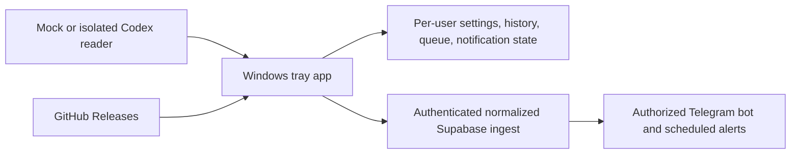

# Codex Usage Companion

Codex Usage Companion is a local-first Windows 11 tray application for monitoring Codex usage windows. It shows the latest known 5-hour and weekly allowance, reset times, device freshness, deduplicated notifications, and optional Telegram delivery through Supabase.

Version 1.0.0 uses a safe mock reader by default. The real Codex readers are isolated behind `ICodexUsageReader`: an experimental, consent-gated OAuth reader follows the current CodexBar-compatible path, and a sandboxed Codex CLI RPC reader is available as a fallback. Neither reader writes Codex credentials.

## What it does not do

The companion never sends a prompt, starts a Codex job, invokes an OpenAI model, intentionally consumes Codex quota, stores a ChatGPT password, scrapes unrelated browser data, injects into ChatGPT, or uses screenshots/OCR as its normal source. Reading already-available rate-limit metadata is passive; it does not make an inference request or incur OpenAI API charges.

## What Version 1 includes

- Windows tray icon with status tooltip and the required context menu.
- Status window with live local countdowns, last read, cloud sync, source, device, and version.
- Settings stored in `%LOCALAPPDATA%\CodexUsageCompanion`, never in the installation folder.
- Supabase sessions encrypted by Windows Credential Manager.
- Durable local history, one newest queued cloud update, retry backoff, and restart-safe notification deduplication.
- 10%, 5%, and 0% short-term alerts; 10% and 5% weekly alerts; reset warning, reset confirmation, offline, restored, and authentication alerts.
- Supabase Row Level Security, normalized snapshots, retention, Edge Functions, cron checks, and a Telegram bot.
- Semantic-version GitHub Release updater with daily-at-most checks, release notes, explicit consent, SHA-256 validation, pre-upgrade backup, and no forced updates.

## Architecture

The detailed boundaries and upgrade flow are in [Architecture](docs/architecture.md).

## Requirements

- Windows 11 x64;
- .NET 8 SDK and Git for development;
- Deno 2.x for Edge Function validation;
- Inno Setup 6 for installer creation;
- optional Supabase CLI/Docker for cloud development;
- optional signing certificate and Windows SDK for a public release.

## Quick start

1. Install the [.NET 8 SDK](https://dotnet.microsoft.com/download/dotnet/8.0).
2. Run `.\scripts\test.ps1`.
3. Run `dotnet run --project .\src\CodexUsageCompanion.App`.
4. Keep **Mock** selected in Settings until you intentionally enable another reader.

The app continues monitoring after its window is closed; use the tray menu's **Exit** command to stop it.

For a self-contained Windows build, see [Windows setup](docs/setup-windows.md). For cloud and Telegram setup, see [Supabase setup](docs/setup-supabase.md) and [Telegram setup](docs/setup-telegram.md).

## Project layout

- `src/CodexUsageCompanion.App` — WPF status/settings windows, tray shell, and runtime coordination.
- `src/CodexUsageCompanion.Core` — normalized models, settings, mock reader, semantic versioning, and notification engine.
- `src/CodexUsageCompanion.Reader.Codex` — isolated experimental Codex reading logic.
- `src/CodexUsageCompanion.Infrastructure` — storage, Credential Manager, logging, Supabase, updater, and startup registration.
- `supabase/migrations` — immutable, versioned database migrations.
- `supabase/functions` — authenticated ingest, Telegram webhook, and scheduled notification delivery.
- `tests` — .NET behavior tests; Edge Function tests live beside their functions.
- `installer` and `scripts` — Windows installer and reproducible build/test entry points.

## Security and privacy

The desktop uploads only normalized usage values, reset timestamps, source freshness, sanitized error codes, app version, and a random device identifier. It does not upload prompts, completions, raw Codex responses, cookies, Codex tokens, Supabase passwords, or machine-wide secrets.

The desktop receives only a Supabase publishable key. Secret keys, Telegram bot tokens, webhook secrets, and cron secrets stay in Supabase-managed server environments. See [Security](docs/security.md) and [SECURITY.md](SECURITY.md).

## Development status and limitations

The Version 1 implementation, mock workflow, updater safeguards, migration, and backend functions are complete and covered by automated tests. The live Codex source remains explicitly experimental because this Windows machine could not launch the packaged Codex CLI for a device-to-UI comparison. Mock mode is therefore the default and the repository must not publish a general-availability installer until the production reader and signing/attribution release gates in [releasing.md](docs/releasing.md) pass.

Version 1 supports Codex only, one authorized Telegram profile/chat, Windows x64, and English UI text. Quiet hours and multi-user bot enrollment are intentionally deferred.

## Documentation

- [Architecture](docs/architecture.md)
- [Codex source investigation](docs/data-source-investigation.md)
- [Windows setup](docs/setup-windows.md)
- [Supabase setup](docs/setup-supabase.md)
- [Telegram setup](docs/setup-telegram.md)
- [Manual test plan](docs/manual-test-plan.md)
- [Resource usage observations](docs/resource-usage.md)
- [Troubleshooting](docs/troubleshooting.md)
- [Release and rollback process](docs/releasing.md)

## Independence

This is an independent project. It is not affiliated with or endorsed by OpenAI or CodexBar. CodexBar was reviewed as a compatibility reference under its MIT license; no CodexBar source is bundled into this application.

No project license has been selected yet. Do not redistribute this repository until the project owner adds one.
