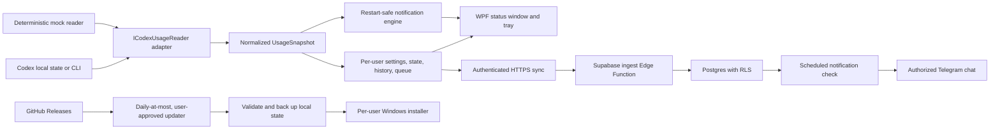

# Architecture

## Design goals

Codex Usage Companion is local-first, upgrade-safe, privacy-preserving, and honest about imperfect data. The app remains useful without Supabase or Telegram, and passage of a reset timestamp never causes the UI to invent a 100% allowance.

## Desktop boundaries

`CodexUsageCompanion.Core` has no UI, operating-system, Supabase, or Codex-specific dependency. It defines normalized percentages, timestamp/freshness rules, settings validation, semantic-version comparison, and notification state transitions.

`CodexUsageCompanion.Reader.Codex` is the only component that knows how CodexBar-compatible OAuth usage or Codex CLI RPC responses look. Both adapters implement `ICodexUsageReader`, so source changes can be shipped without rewriting storage, UI, notifications, synchronization, or updates.

`CodexUsageCompanion.Infrastructure` owns operating-system and network edges:

- `%LOCALAPPDATA%\CodexUsageCompanion` JSON files with atomic replacement;
- Windows Credential Manager for rotating Supabase sessions;
- structured, redacted, size-bounded logs;
- normalized Supabase requests and retry scheduling;
- GitHub Release parsing, semantic-version comparison, SHA-256 download verification, and upgrade backups;
- current-user startup registration.

`CodexUsageCompanion.App` composes these parts. It samples every two minutes while Codex or ChatGPT is active and every five minutes otherwise, subject to user settings. A semaphore prevents overlapping reads.

## WPF versus WinUI 3

WPF was selected for Version 1 because it is mature, ships with .NET desktop support, has straightforward per-user deployment, and interoperates reliably with the Windows notification area and WinRT toast APIs. WinUI 3 offers newer controls but adds Windows App SDK packaging/lifecycle complexity that does not improve this small tray utility's safety or resource profile. The UI boundary is small enough to revisit later without moving reader, storage, notification, or backend logic.

## Local state and upgrade safety

The installation defaults to `%LOCALAPPDATA%\Programs\Codex Usage Companion`. Mutable data is separate:

- `settings.json` — validated preferences and public configuration;
- `state.json` — latest reading, bounded 30-day history, newest pending upload, notification keys, and update-check timestamp;
- `logs` — redacted structured logs;
- `backups` — timestamped pre-upgrade copies and manifest;
- `updates` — SHA-256-verified installers retained for recovery;
- Windows Credential Manager — Supabase access/refresh session.

The installer invokes the currently installed app with `--prepare-upgrade` before replacing files. The old version validates settings and writes a backup. A validation failure aborts the installer.

## Synchronization model

Only the newest unsynchronized snapshot is queued because the server stores latest status separately and keeps meaningful history. A changed window or hourly heartbeat enters history; identical high-frequency samples do not. Temporary failures use bounded exponential backoff with jitter. Authentication or validation failures are not retried as network failures.

The ingest function validates exact keys, lengths, timestamps, percentages, UUIDs, and semantic versions. It resolves the user from their Auth JWT, then calls a typed Postgres function under that identity. Row Level Security additionally isolates all user-owned tables.

## Notification model

Each notification has a stable key scoped to its event and reset cycle. Delivered keys and per-window threshold state are persisted before restart. Thresholds rearm only when a confirmed reading rises above the threshold margin or a reset is confirmed from both a later reset boundary and increased remaining allowance.

When a known reset time passes, the app says it is waiting for confirmation. It displays 100% only when a real reading reports 100%.

## Supabase schema lifecycle

Every schema change gets a new timestamped file in `supabase/migrations`. A migration that reached any shared environment is immutable. Compatibility follows expand/migrate/contract so an older desktop release can continue operating while a newer one rolls out.
